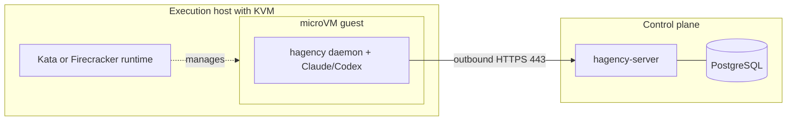

[中文](REMOTE_EXECUTION.zh-CN.md) · [Documentation](README.md)

# Remote execution plane (Kata / Firecracker)

hagency-server never starts model or tool processes. Owner daemons pull work over
outbound HTTPS, so the execution plane can run on other hosts. This guide covers
running those daemons in microVMs and letting the server refuse shared work to
executors an administrator has not attested.

## 1. Topology

Control plane: hagency-server, PostgreSQL, nginx. Execution hosts: Linux x86_64
with KVM, one microVM per executor; inside the guest run `hagency daemon` and
Claude Code / Codex.



No inbound connection to execution hosts is needed, and the server never calls a
hypervisor. The VM driver belongs to the daemon (hagency-desktop), not this repo.

## 2. Runtime choice

| Option | Notes |
| --- | --- |
| Kata Containers 3.x + Cloud Hypervisor or QEMU (default) | virtio-fs; works with containerd/nerdctl or a Docker `default-runtime`. |
| Kata + Firecracker (`kata-fc`) | Needs the containerd devmapper snapshotter; no virtio-fs. |
| Raw Firecracker + `jailer` | You own the rootfs and kernel lifecycle. |

## 3. Host hardening

Follow Firecracker's [production host setup](https://github.com/firecracker-microvm/firecracker/blob/main/docs/prod-host-setup.md) and [jailer](https://github.com/firecracker-microvm/firecracker/blob/main/docs/jailer.md):

- cgroup v2 CPU, memory and pids limits per VM;
- Firecracker: jailer chroot and an unprivileged uid per VM; keep seccomp on;
- disable KSM and swap (side channels); keep the host kernel patched;
- restrict `/dev/kvm` to the runtime's group.

## 4. Network

Per-VM tap/bridge with an nftables egress allowlist: the hagency-server domain,
the LiteLLM endpoint, the git remote over SSH, package mirrors. Pin DNS. Block
host metadata and the LAN.

## 5. Credentials

Inside the guest only the device bearer and scoped LiteLLM virtual keys with
budgets. Never the owner account, never a container-engine socket; use one git
deploy key per repository.

## 6. Enrolment and attestation runbook

1. Enrol inside the guest: `hagency daemon enroll --server <url> --owner <@id:server>`.
2. Verify the VM out-of-band (`kata-runtime check`; guest `uname -r` differs from the host).
3. As administrator, list devices and attest:

```sh
curl -sS -X POST https://<server>/hagency/api/v1/management/executor-isolation/query -H "authorization: Bearer $ADMIN" -H 'content-type: application/json' -d '{}'
curl -sS -X POST https://<server>/hagency/api/v1/management/executor-isolation/<deviceId>/attest -H "authorization: Bearer $ADMIN" -H 'content-type: application/json' -d '{"kind":"kata","hostLabel":"exec-01","expectedGeneration":<generation>,"validForDays":90}'
curl -sS -X POST https://<server>/hagency/api/v1/management/executor-isolation/<deviceId>/revoke -H "authorization: Bearer $ADMIN" -H 'content-type: application/json' -d '{}'
```

`kind` is `kata` or `firecracker`. `validForDays` (1-365, default 90) sets the
attestation lifetime; an expired attestation stops satisfying the gate at the
worker's next request, so re-attest before it lapses. Review history with:

```sh
curl -sS -X POST https://<server>/hagency/api/v1/management/executor-isolation/audit -H "authorization: Bearer $ADMIN" -H 'content-type: application/json' -d '{}'
```

Re-enrolment bumps the device generation and
voids the attestation. Owners see `isolationKind` / `isolationHost` on their
devices.

## 7. Server policy

```toml
[management]
require_isolated_executor = true
```

- Shared-execution worker requests from unattested devices get HTTP 409 `executor_isolation_required`.
- Pending messages show reason `executor_isolation_required`.
- `activity/renew` and result/recover routes are never refused, so started work settles.
- Personal-Agent `/execution/*` routes are unchanged.
- The session feature list gains `executor-isolation-required-v1` when enabled.

Trust model: the attestation is an administrator statement about one device
generation, not cryptographic remote attestation. Confidential Containers /
peer-pods attestation is the stronger option.

## 8. References

- [Kata peer-pods architecture](https://github.com/confidential-containers/cloud-api-adaptor/blob/main/docs/architecture.md)
- [Firecracker production host setup](https://github.com/firecracker-microvm/firecracker/blob/main/docs/prod-host-setup.md), [jailer](https://github.com/firecracker-microvm/firecracker/blob/main/docs/jailer.md)
- [E2B runtime](https://github.com/e2b-dev/runtime)
- [Kubernetes Agent Sandbox Firecracker example](http://agent-sandbox.sigs.k8s.io/docs/use-cases/examples/firecracker-sandbox)
