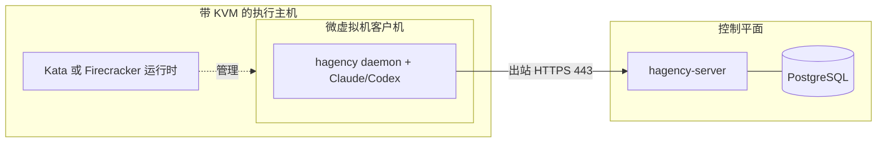

[English](REMOTE_EXECUTION.md) · [文档](README.md)

# 远程执行平面（Kata / Firecracker）

hagency-server 从不启动模型或工具进程。所有者守护进程通过出站 HTTPS 拉取任务，
因此执行平面可以运行在其他主机上。本文说明如何把守护进程放进微虚拟机，并让服务器
拒绝向管理员未证明的执行器派发共享任务。

## 1. 拓扑

控制平面：hagency-server、PostgreSQL、nginx。执行主机：支持 KVM 的 Linux x86_64，
每个执行器一个微虚拟机；客户机内运行 `hagency daemon` 与 Claude Code / Codex。



执行主机无需任何入站连接，服务器也从不调用虚拟机监控器。虚拟机驱动属于守护进程
（hagency-desktop），不在本仓库。

## 2. 运行时选择

| 方案 | 说明 |
| --- | --- |
| Kata Containers 3.x + Cloud Hypervisor 或 QEMU（默认） | virtio-fs；配合 containerd/nerdctl 或 Docker `default-runtime`。 |
| Kata + Firecracker（`kata-fc`） | 需要 containerd devmapper 快照器；无 virtio-fs。 |
| 原生 Firecracker + `jailer` | 自行管理 rootfs 与内核生命周期。 |

## 3. 主机加固

遵循 Firecracker 的[生产主机设置](https://github.com/firecracker-microvm/firecracker/blob/main/docs/prod-host-setup.md)与 [jailer](https://github.com/firecracker-microvm/firecracker/blob/main/docs/jailer.md)：

- 每个虚拟机使用 cgroup v2 限制 CPU、内存和 pids；
- Firecracker：每个虚拟机使用 jailer chroot 与非特权 uid，保持 seccomp 开启；
- 关闭 KSM 与交换（侧信道），保持主机内核更新；
- 仅运行时所属用户组可访问 `/dev/kvm`。

## 4. 网络

每个虚拟机独立 tap/bridge，并用 nftables 出站白名单：hagency-server 域名、LiteLLM 端点、
通过 SSH 访问的 git 远端、软件包镜像。固定 DNS；阻断主机元数据与局域网。

## 5. 凭据

客户机内只放设备 bearer 与带预算的 LiteLLM 虚拟密钥。不放所有者账号，不挂载容器引擎
socket；每个仓库使用独立的 git deploy key。

## 6. 注册与证明流程

1. 在客户机内注册：`hagency daemon enroll --server <url> --owner <@id:server>`。
2. 带外验证虚拟机（`kata-runtime check`；客户机 `uname -r` 与主机不同）。
3. 管理员列出设备并证明：

```sh
curl -sS -X POST https://<server>/hagency/api/v1/management/executor-isolation/query -H "authorization: Bearer $ADMIN" -H 'content-type: application/json' -d '{}'
curl -sS -X POST https://<server>/hagency/api/v1/management/executor-isolation/<deviceId>/attest -H "authorization: Bearer $ADMIN" -H 'content-type: application/json' -d '{"kind":"kata","hostLabel":"exec-01","expectedGeneration":<generation>}'
curl -sS -X POST https://<server>/hagency/api/v1/management/executor-isolation/<deviceId>/revoke -H "authorization: Bearer $ADMIN" -H 'content-type: application/json' -d '{}'
```

`kind` 为 `kata` 或 `firecracker`。重新注册会提升设备 generation，使证明失效。
所有者可在自己的设备上看到 `isolationKind` / `isolationHost`。

## 7. 服务器策略

```toml
[management]
require_isolated_executor = true
```

- 未证明设备的共享执行 worker 请求返回 HTTP 409 `executor_isolation_required`。
- 待处理消息显示原因 `executor_isolation_required`。
- `activity/renew` 与结果/恢复路由从不被拒绝，已开始的任务可以结算。
- 个人 Agent 的 `/execution/*` 路由不变。
- 启用后会话功能列表增加 `executor-isolation-required-v1`。

信任模型：证明是管理员对某一设备 generation 的声明，不是密码学远程证明。更强的方案是
Confidential Containers / peer-pods 证明。

## 8. 参考

- [Kata peer-pods 架构](https://github.com/confidential-containers/cloud-api-adaptor/blob/main/docs/architecture.md)
- [Firecracker 生产主机设置](https://github.com/firecracker-microvm/firecracker/blob/main/docs/prod-host-setup.md)、[jailer](https://github.com/firecracker-microvm/firecracker/blob/main/docs/jailer.md)
- [E2B runtime](https://github.com/e2b-dev/runtime)
- [Kubernetes Agent Sandbox Firecracker 示例](http://agent-sandbox.sigs.k8s.io/docs/use-cases/examples/firecracker-sandbox)
